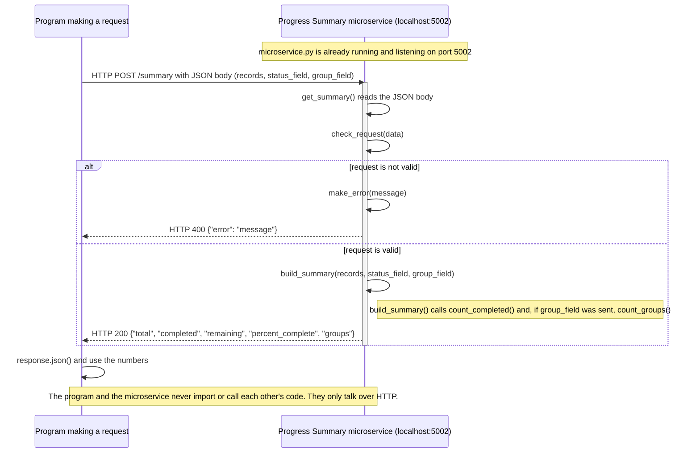

# Progress Summary Microservice

**Team:** Michael Breaux and Toby Stanley Jr. (CS361, Group 15)

## What it does
Send this microservice a list of records (like tasks or climbing sessions). It sends back:

- **total**: how many records there are
- **completed** and **remaining**: how many records have the status field set to `true`, and how many don't
- **percent_complete**: completed ÷ total × 100, rounded to 1 decimal
- **groups** (optional): how many records have each value of a field you choose (e.g. tasks per course, sessions per month)

An empty list returns all zeros. A record that is missing the status field counts as not completed.

## Communication contract

| | |
|---|---|
| **Communication pipe** | REST API over HTTP, JSON |
| **URL** | `http://localhost:5002/summary` |
| **Method** | `POST` |

### How to run it
```
pip install flask requests
python microservice.py
```
Leave it running. Your program can now send requests to it.

### How to REQUEST data
Send an HTTP **POST** request to `http://localhost:5002/summary` with a JSON body:

| Parameter | Type | Required? | Description |
|---|---|---|---|
| `records` | list of JSON objects | Yes | The records to summarize. |
| `status_field` | string | At least one of these two | The true/false field that means "completed", e.g. `"done"`. |
| `group_field` | string | At least one of these two | A field to count by, e.g. `"course"` or `"month"`. |

**Example request (Python):**
```python
import requests

tasks = [{"title": "Essay", "course": "CS361", "done": True},
         {"title": "Quiz 3", "course": "CS325", "done": False}]

response = requests.post("http://localhost:5002/summary",
    json={"records": tasks, "status_field": "done", "group_field": "course"})
```

### How to RECEIVE data
The microservice answers the same request with an HTTP response that has a JSON body.

**Success (status 200):**
```json
{
  "total": 2,
  "completed": 1,
  "remaining": 1,
  "percent_complete": 50.0,
  "groups": {"CS361": 1, "CS325": 1}
}
```
`groups` is only included when `group_field` was sent. Records missing the group field are counted under `"(missing)"`.

**Error (status 400):** the request was missing something or had a wrong value. The message says what to fix:
```json
{"error": "records is required and must be a list, like [{\"title\": \"Essay\", \"done\": true}]."}
```

**Example of receiving the data (Python):**
```python
data = response.json()

if response.status_code == 200:
    print("Completed:", data["completed"], "of", data["total"])
    print("Percent complete:", data["percent_complete"])
    for course in data["groups"]:
        print(course, data["groups"][course])
else:
    print("Error:", data["error"])
```

## UML sequence diagram



## Test program
`test_program.py` shows a full request and response. Start the microservice first, then in a second terminal:
```
python test_program.py
```
